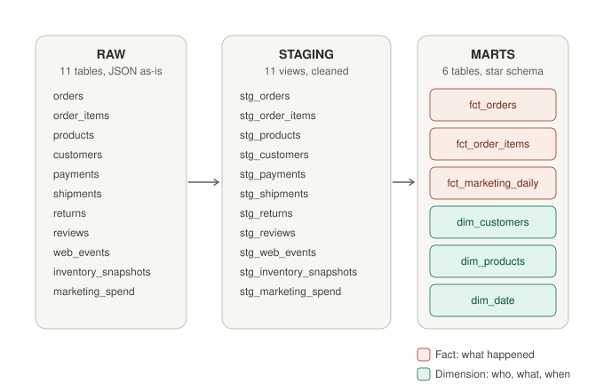
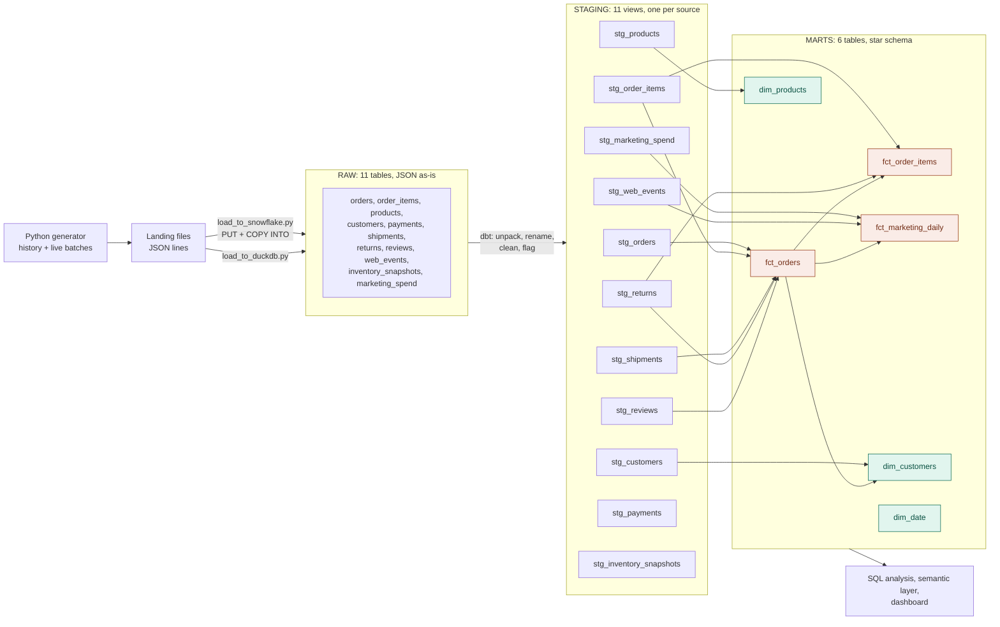

# DutchCart Analytics

**An end-to-end e-commerce analytics project for a (simulated) Dutch online shop.**
Python → Snowflake / DuckDB → dbt (staging, marts, tests) → SQL analysis → semantic layer → dashboard

---

## The business problem

DutchCart is a fictional Dutch online shop selling Fashion, Shoes, Electronics, Home, Beauty and Sports, delivered by PostNL, DHL and DPD.

Sales are coming in, but management suspects **profit is leaking**:

- many **returns**, especially in Fashion and Shoes
- rising **ad spend** across Google, Instagram, TikTok, TV and radio, with no clear view of what pays off
- complaints about **late parcels**
- many website visitors **leave without buying**

The CEO's question:

> **"Where are we losing money, and where should we put next quarter's budget?"**

## Stakeholders and the questions this project answers

| Stakeholder | Question | KPI |
|---|---|---|
| CEO / Finance | Are we growing? Where does revenue come from? | Revenue, orders, average order value (AOV) |
| Marketing | Which channel is worth the money? | ROAS (revenue ÷ ad spend) per channel |
| Customer / CRM | Do customers come back? | Repeat customer rate, customer value segments |
| Operations | Which carrier is late, and what does it cost us? | Late delivery %, returns and bad reviews after late delivery |
| Category / Buying | Which categories lose money through returns? | Return rate and revenue lost per category |
| E-commerce / Web | Where do visitors drop off? | Funnel conversion: view → cart → checkout → purchase |

## Architecture



<details>
<summary>Detailed lineage: which staging views feed each mart</summary>



</details>

Facts (coral) record **what happened** (orders, items, marketing days). Dimensions (green) describe **who, what and when** (customers, products, dates). `dim_date` is generated (a calendar), and `stg_payments` / `stg_inventory_snapshots` are ready for later analyses.

**Why 11 staging models but only 6 marts?** Staging follows the *sources* (one view per source table). Marts follow the *business questions*, and one mart often combines several staging views.

| Layer | Schema (Snowflake and DuckDB) | What happens |
|---|---|---|
| **Raw** (bronze) | `RAW` | Files loaded as-is into a JSON column (`VARIANT` in Snowflake), with file name and load time |
| **Staging** (silver) | `STAGING` | One view per source: JSON unpacked, columns renamed and typed, bad data fixed or flagged |
| **Marts** (gold) | `MARTS` | Business-ready tables in a star schema: facts (events) and dimensions (who / what) |

## Data

The data is **simulated with realistic business patterns** by `generator/live_feed.py`: 11 source tables (orders, order items, products, customers, payments, shipments, returns, reviews, web events, inventory snapshots, marketing spend), 180 days of history, plus "live" batches on demand.

Data-quality problems are added **on purpose**, so the pipeline has real issues to solve:

| Problem | How it is handled |
|---|---|
| Prices stored as text (`"€19,99"`) | **Fixed** in staging: cleaned and cast to a number |
| Duplicate web events | **Removed** with `row_number()` + `qualify` |
| Orders dated in the future | **Flagged** in staging, **excluded** from marts |
| Missing email, postcode or delivery date | **Flagged** (`is_missing_...`), not deleted |

Rule used: *fix what is certain, flag what is not.*

## Data quality and testing

Every model is tested with dbt (all passing):

- `unique` / `not_null` on every key, which also guards against join fan-out in the marts
- `relationships`, e.g. every order item belongs to an existing order and product
- `accepted_values` for statuses, channels, carriers, payment methods and so on
- **Reconciliation test**: the sum of order-item revenue must match each order's subtotal (source-to-target check)

## dbt models

**Staging (11):** `stg_orders`, `stg_order_items`, `stg_products`, `stg_customers`, `stg_payments`, `stg_shipments`, `stg_returns`, `stg_reviews`, `stg_web_events`, `stg_inventory_snapshots`, `stg_marketing_spend`

**Marts:**

| Model | Type | Grain (one row =) | Answers |
|---|---|---|---|
| `fct_orders` | fact | one order (items, delivery, return, review) | revenue, AOV, late delivery, returns |
| `fct_order_items` | fact | one product in a paid order | best sellers, return rate per category |
| `fct_marketing_daily` | fact | one channel per day (spend, visits, orders, revenue) | ROAS, cost per order |
| `dim_customers` | dimension | one customer (lifetime orders, revenue, segment) | repeat rate, best customers |
| `dim_products` | dimension | one product (category, price, margin) | category and margin analysis |
| `dim_date` | dimension | one calendar day | trends by month, weekday, TV days |

Planned: `fct_sessions` (website funnel) and a semantic layer with metric definitions.

**Runs on two databases:** the same models build on **Snowflake** and on **DuckDB** (free, local). Small adapter-aware macros in `macros/cross_db.sql` write the right SQL for each, e.g. `{{ json_field('order_id', 'string') }}` becomes `record:order_id::string` on Snowflake and `cast(record->>'order_id' as varchar)` on DuckDB.

## Project structure

```
dutchcart-analytics/
├── generator/live_feed.py         # simulates the shop (history + live batches)
├── loader/load_to_snowflake.py    # PUT + COPY INTO Snowflake RAW, then archives files
├── loader/load_to_duckdb.py       # same RAW tables in a local DuckDB file
├── dutchcart/                     # dbt project
│   ├── models/staging/            # 11 staging models + sources + tests
│   ├── models/marts/              # facts and dimensions
│   ├── macros/                    # schema naming + cross-database helpers
│   ├── ci/profiles.yml            # connection settings for CI (no secrets)
│   └── tests/                     # custom data tests (reconciliation)
├── snowflake/sql/                 # exploration queries
├── pyproject.toml / uv.lock       # Python dependencies (uv)
└── README.md
```

## How to run

Requirements: Python 3.13 and [uv](https://docs.astral.sh/uv/). Snowflake is optional: the project runs fully on DuckDB.

```bash
# 1. install dependencies
uv sync

# 2. generate data
uv run python generator/live_feed.py history --days 180
uv run python generator/live_feed.py live --batches 10 --interval 5   # optional: new data
```

**Option A: DuckDB (free, local, no account)**

```bash
uv run python loader/load_to_duckdb.py
cd dutchcart
uv run dbt build --target duckdb        # needs a "duckdb" target in ~/.dbt/profiles.yml
```

Query the result in a browser with the DuckDB UI: `duckdb -ui dutchcart.duckdb` (close it before the next build: DuckDB allows one writer at a time).

**Option B: Snowflake**

```bash
# .env with SNOWFLAKE_ACCOUNT, SNOWFLAKE_USER, SNOWFLAKE_PASSWORD (never committed)
uv run python loader/load_to_snowflake.py
cd dutchcart
uv run dbt build --target dev
```

## Roadmap

- [x] Data generator with realistic dirty data
- [x] Snowflake loader (internal stage, COPY INTO)
- [x] dbt staging layer with tests
- [x] Marts: 3 facts + 3 dimensions in a star schema
- [x] Portable: runs on Snowflake and DuckDB (cross-database macros)
- [ ] Website funnel mart (`fct_sessions`)
- [ ] Semantic layer: metrics defined once in dbt (MetricFlow)
- [ ] SQL analysis per stakeholder question
- [ ] Dashboard on top of the metrics
- [ ] Insights memo: 3 findings and 3 recommendations
- [ ] CI with GitHub Actions (`dbt build` on every pull request)

## Key findings

*Coming after the analysis step.*

---

**Author:** Puja Verma · [LinkedIn](https://linkedin.com/in/puja-verma-19b668103) · [GitHub](https://github.com/puja-verma11)
